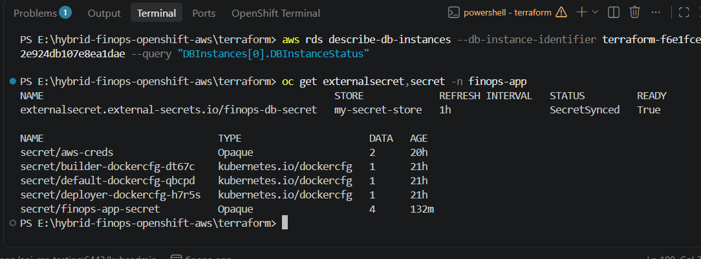
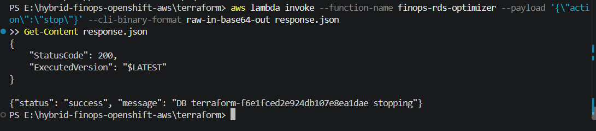
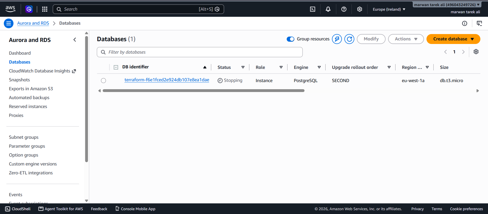
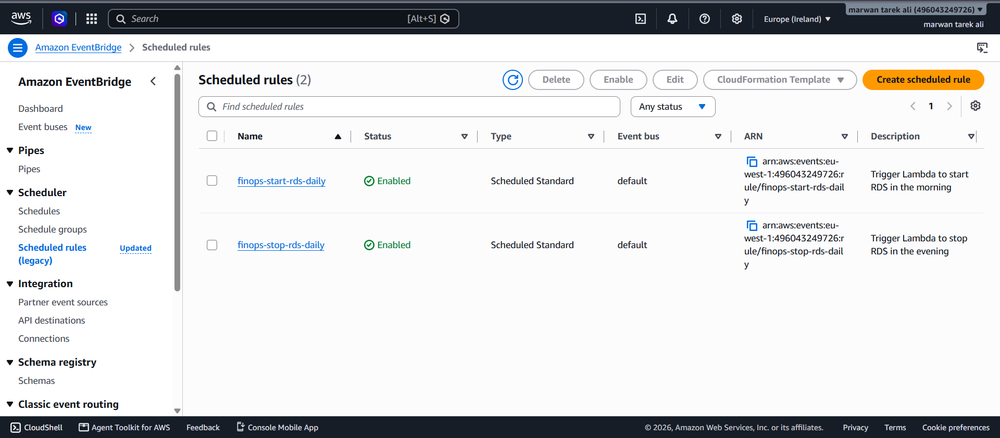
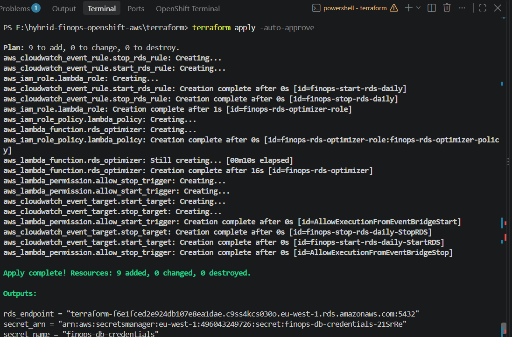

```markdown
# Hybrid Cloud FinOps & Security Platform: OpenShift & AWS Integration

A production-grade, GitOps-ready Hybrid Cloud architecture demonstrating enterprise FinOps cost automation and zero-trust secrets management across **Red Hat OpenShift** and **Amazon Web Services (AWS)**.

---

## 🎯 Architecture Overview & Problem Statement

In enterprise hybrid environments, running non-production workloads continuously and managing multi-platform credentials lead to two major operational bottlenecks:
1. **Cloud Cost Leakage:** Development databases (AWS RDS PostgreSQL) left running 24/7 generate idle compute costs during off-hours, weekends, and idle windows.
2. **Secrets Proliferation & Drift:** Duplicating or hardcoding database credentials across clusters creates severe security risks, synchronization drift, and compliance violations.

### The Solution:
- **Zero-Trust Secret Synchronization:** Automated pulling of secrets from **AWS Secrets Manager** directly into **Red Hat OpenShift** namespaces using the **External Secrets Operator (ESO)** without exposing credentials in Git.
- **Smart FinOps Cost Optimization:** Event-driven, tag-aware automation using **AWS Lambda (Python 3.9)** and **Amazon EventBridge** to enforce automated stop/start schedules on RDS PostgreSQL instances with override safeguards.

---

## 🏛️ System Architecture

```text
       +--------------------------------------------------------------+
       |                  Red Hat OpenShift Cluster                  |
       |                                                              |
       |  +--------------------+         +-------------------------+  |
       |  |  SecretStore (AWS) |<--------| ExternalSecrets Operator|  |
       |  +---------+----------+         +------------+------------+  |
       |            |                                 |               |
       |            |                                 v               |
       |            |                      +--------------------+     |
       |            |                      | K8s Native Secret  |     |
       |            |                      +--------------------+     |
       +------------|---------------------------------+---------------+
                    | (IAM Auth)                      ^
                    v                                 | (Encrypted Sync)
       +----------------------------------------------+---------------+
       |                      Amazon Web Services                     |
       |                                                              |
       |    +------------------------+      +--------------------+    |
       |    |   AWS Secrets Manager  |      | Amazon EventBridge |    |
       |    +------------------------+      +---------+----------+    |
       |                                              | (Cron Event)  |
       |                                              v               |
       |    +------------------------+      +--------------------+    |
       |    |   Amazon RDS Postgres  |<-----+ AWS Lambda (Python)|    |
       |    +------------------------+      +--------------------+    |
       |        (State: Stopped)                (Cost Optimizer)      |
       +--------------------------------------------------------------+

```

---

## 🛠️ Tech Stack & Key Components

* **Cloud Platform:** Amazon Web Services (AWS) — RDS PostgreSQL, Secrets Manager, Lambda, EventBridge, IAM, VPC.
* **Container Platform:** Red Hat OpenShift Container Platform / Kubernetes.
* **Infrastructure as Code (IaC):** HashiCorp Terraform.
* **Security & Secrets:** External Secrets Operator (ESO), Kubernetes SecretStore CRD, AWS IAM Policies.
* **Automation / Scripting:** Python (`boto3`), Bash / PowerShell.

---

## 🚀 Key Implementations

### 1. Hybrid Secret Synchronization (OpenShift + AWS)

* Deployed and configured the **External Secrets Operator (ESO)** on OpenShift.
* Linked OpenShift securely to AWS using scoped IAM credentials.
* Real-time synchronization of database credentials (`finops-db-credentials`) into native OpenShift secrets (`finops-app-secret`).

### 2. Tag-Aware FinOps Cost Optimizer

* Implemented an **AWS Lambda function** in Python using the `boto3` SDK.
* Configured automated cron schedules via **Amazon EventBridge**:
* `finops-stop-rds-daily`: Triggers database shutdown every evening (`cron(0 20 ? * * *)`).
* `finops-start-rds-daily`: Starts up instances at the beginning of the workday (`cron(0 8 ? * * *)`).


* **Tag Safeguard / Override:** The Lambda inspects instance tags (`AutoStop = false`) before issuing actions, preventing unexpected shutdowns during critical test cycles.

---

## 📸 Verification & Proof of Execution

### 1. OpenShift Secret Sync (ESO)

Status `SecretSynced` with native secret created in `finops-app` namespace:


### 2. Lambda Execution & Status Validation

AWS Lambda invoked with action payload returning status code `200` and executing instance state change:

### 3. RDS Instance State (Stopping / Stopped)

AWS RDS console confirming state transition to reduce compute cost to $0 during non-business hours:


### 4. Amazon EventBridge Scheduler Rules

Configured automated triggers enforcing daily schedules:


### 5. Terraform Infrastructure Deployment

Clean declarative apply creating VPC, RDS, Secrets, IAM, and Lambda resources:


---

## 📂 Repository Structure

```plaintext
hybrid-finops-openshift-aws/
├── docs/
│   └── images/                   # Architecture proofs and execution logs
├── openshift/
│   ├── secret-store.yaml         # OpenShift SecretStore definition for AWS
│   └── external-secret.yaml      # ExternalSecret CRD mapping AWS credentials
└── terraform/
    ├── main.tf                   # Provider definitions
    ├── vpc.tf                    # Custom networking & subnets
    ├── rds.tf                    # AWS PostgreSQL RDS configuration
    ├── secrets.tf                # AWS Secrets Manager setup
    ├── cost-optimizer.tf         # Lambda, IAM, and EventBridge automation
    └── lambda_function.py        # Python boto3 Cost Optimization logic

```

```

```